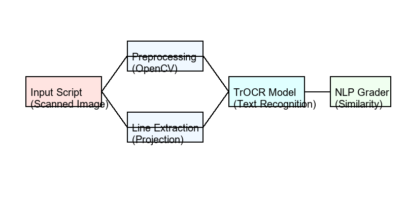
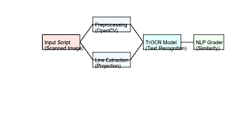
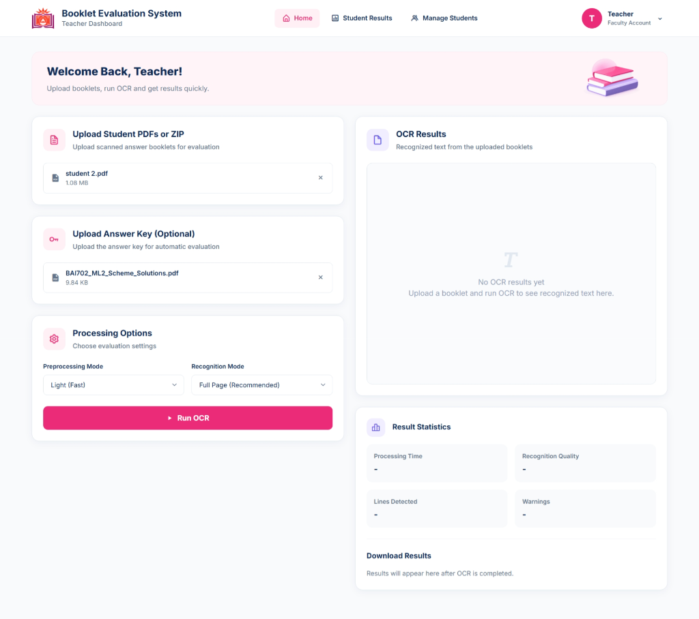
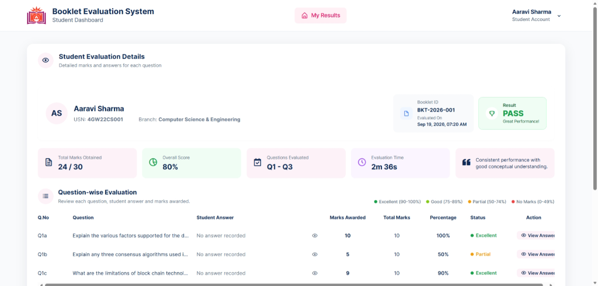

# Automated Handwritten Booklet Evaluation System

[](https://www.python.org/downloads/)
[](https://fastapi.tiangolo.com)
[](https://pytorch.org/)
[](https://huggingface.co/microsoft/trocr-large-handwritten)
[](https://www.mysql.com/)

A full-stack, offline-capable digital answer booklet evaluation platform powered by Microsoft's `trocr-large-handwritten` model, optimized projection peak line detection, automated semantic grading, and a responsive web dashboard.

---

## 📸 System Architecture & Dashboards

### Architecture Overview


### Evaluation Flow


### Faculty & Student Portals
| Teacher Dashboard | Student Dashboard |
|:---:|:---:|
|  |  |

---

## 🌟 Key Features

1. **High-Accuracy Offline OCR Engine (`ocr_core/`)**:
   - Uses `microsoft/trocr-large-handwritten` with full-precision FP32 inference for 100% reading accuracy.
   - Optimized SciPy projection peak line detection for fast, clean text segmentation.
   - Multi-page booklet processing speed reduced from ~10 mins to ~3.8 mins per 3-page booklet on standard CPU.
   - Automatic fallback to NVIDIA CUDA GPU acceleration when available.

2. **Automated Multi-Question Extraction & Grading (`ocr_core/grader.py`)**:
   - Intelligently recognizes question anchors (e.g., `1a`, `1b`, `1c`, `Q1`, `Q2`).
   - Distinguishes internal itemized points (e.g., `1.`, `2.`, `3.`) from top-level question headers, eliminating phantom questions.
   - Evaluates student answers against standard answer keys using semantic similarity.
   - Accurately assigns `0.0` marks to unanswered questions.

3. **Multi-Page PDF & ZIP Archive Upload**:
   - Upload single-page or multi-page booklet PDFs.
   - Batch upload ZIP archives containing multiple student answer booklets and evaluate them concurrently.
   - Integrated progress tracking and error reporting.

4. **Faculty & Student Portals (`frontend/`)**:
   - **Faculty Dashboard**: Upload booklets and answer keys, trigger AI evaluation, review and override grades, manage student enrollments.
   - **Student Portal**: View breakdown of marks question-by-question, teacher comments, and verified results.
   - User authentication powered by JWT tokens and bcrypt password hashing.

5. **Production MySQL Database Integration**:
   - Relational database schema with models for Students, Teachers, Student Answers, and Booklet Results.
   - Automatic table generation and duplicate clean-up on re-evaluation.

---

## 🚀 Quick Start (Windows)

### 1. Prerequisites
- **Python 3.10+** (Python 3.10 - 3.13)
- **XAMPP / MySQL Server** (Database named `evaluation` running on port 3306)

### 2. Automated 1-Click Setup
Double-click `setup.bat` or run in terminal:
```powershell
.\setup.bat
```
This automatically:
- Creates a Python virtual environment (`.venv`)
- Installs PyTorch (CPU/CUDA) and all dependencies
- Downloads the `trocr-large-handwritten` model weights (~1.5 GB) locally for 100% offline usage.

### 3. Launch Application
Double-click `run.bat` or run:
```powershell
.\run.bat
```
This script:
- Verifies virtual environment and model files.
- Automatically checks and starts MySQL service if not running.
- Launches the FastAPI backend on port `8000`.
- Automatically opens your web browser to `http://127.0.0.1:8000`.

---

## 🔑 Default Credentials

| Portal | URL | Username | Password |
|---|---|---|---|
| **Faculty Portal** | `http://127.0.0.1:8000` | `gsssteacher` | `gsss@23` |
| **Student Portal** | `http://127.0.0.1:8000` | `4GW23AI001` | `stu@123` |

---

## 💻 CLI & Developer Usage

### Command-Line OCR
Recognize an individual image or booklet PDF directly from terminal:
```powershell
python ocr.py "test_images/sample.png"
```
Options:
- `--preprocess light` (choices: `none`, `light`, `medium`, `strong`)
- `--single-line` (treat input as a single isolated line)
- `--json` (output raw JSON to stdout)
- `--output <dir>` (save recognized `.txt` and `.json` to directory)

### Accuracy Evaluation
Evaluate CER and WER against ground truth datasets:
```powershell
python evaluate.py --images-dir evaluation/images --gt-dir evaluation/ground_truth
```

### Model Fine-Tuning
Fine-tune TrOCR on custom handwriting datasets:
```powershell
python train.py --dataset-dir /path/to/dataset --epochs 3 --batch-size 4
```

---

## 📁 Repository Structure

```text
├── assets/                  # Architecture diagrams and system UI screenshots
├── backend/                 # FastAPI REST API & database application
│   ├── app/
│   │   ├── models/          # SQLAlchemy database models (Student, Teacher, Results)
│   │   ├── routes/          # API endpoints (Auth, Faculty evaluation, Student views)
│   │   ├── schemas/         # Pydantic request/response validation schemas
│   │   ├── security/        # JWT & bcrypt authentication
│   │   ├── services/        # Business logic services
│   │   ├── database.py      # MySQL engine & session management
│   │   └── main.py          # FastAPI application entry point
├── frontend/                # Responsive HTML5/CSS3/JavaScript web interface
│   ├── css/                 # Global, dashboard, and login stylesheets
│   ├── js/                  # Asynchronous API integration and UI controllers
│   ├── assets/              # Icons and illustrations
│   ├── index.html           # Unified login portal
│   ├── teacher-dashboard.html # Booklet upload & evaluation dashboard
│   ├── student-dashboard.html # Student results breakdown portal
│   └── student-management.html# Student records management
├── ocr_core/                # High-speed TrOCR recognition & grading engine
│   ├── config.py            # Central configurations & performance settings
│   ├── db.py                # Database persistence helper for OCR scores
│   ├── errors.py            # Custom exception classes
│   ├── evaluator.py         # CER/WER calculation metrics
│   ├── grader.py            # Automated answer matching and grading logic
│   ├── line_detector.py     # Peak line segmentation
│   ├── model.py             # Singleton TrOCR model loader
│   ├── postprocessor.py     # Text cleaning & quality heuristics
│   ├── preprocessing.py     # Orientation correction, deskew, and contrast enhancement
│   ├── qa_extractor.py      # Question and sub-question header parsing
│   ├── recognizer.py        # Multi-page booklet and image recognition engine
│   └── utils.py             # Logging, timing, and file helpers
├── test_images/             # Sample test images for verification
├── tests/                   # Pytest automated test suite
├── download_model.py        # One-time model downloader
├── ocr.py                   # Standalone CLI recognition tool
├── evaluate.py              # Ground-truth evaluation script
├── train.py                 # Fine-tuning scaffold
├── requirements.txt         # Project Python dependencies
├── setup.bat                # Windows 1-click installer
└── run.bat                  # Windows 1-click application runner
```

---

## ⚙️ Configuration (`.env`)

Copy `.env.example` to `.env` to customize settings:
```ini
# Database Connection (MySQL default)
DATABASE_URL=mysql+pymysql://root:@localhost/evaluation

# Offline Mode (true after model is downloaded)
OFFLINE_MODE=true

# Generation parameters
MAX_NEW_TOKENS=40
NUM_BEAMS=1
PDF_RENDER_SCALE=2.083
```

---

## 📄 License
This project is licensed under the MIT License.
